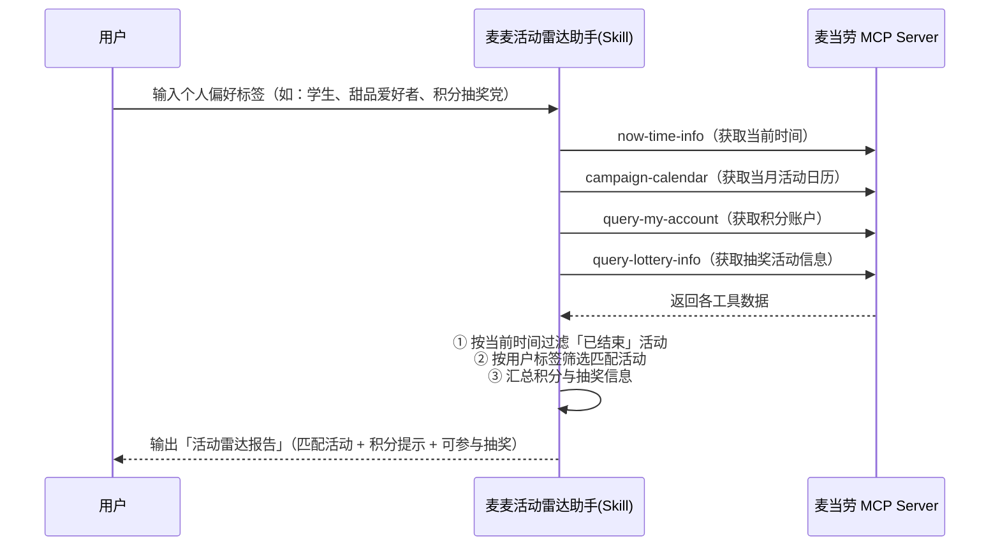
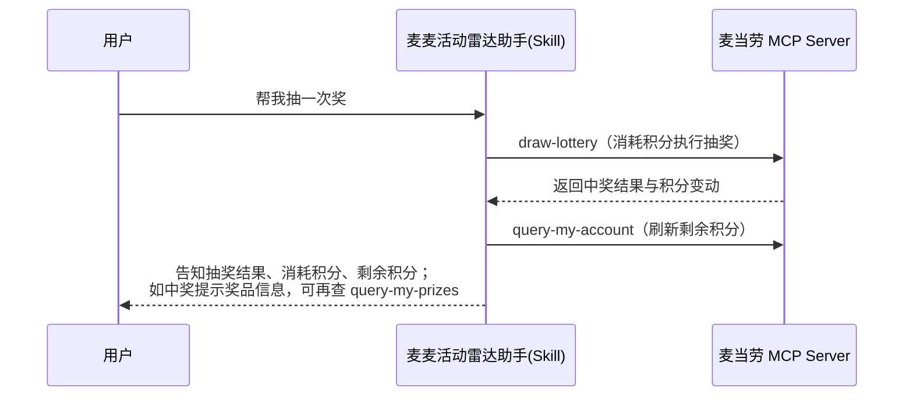

# MCP 集成说明（MCP_INTEGRATION.md）

> 本文档说明「麦麦活动雷达助手」实际使用的麦当劳 MCP Server、Tool、调用流程与业务价值。
> 所有 Tool 名称均以官方 [M-China/mcd-mcp-server](https://github.com/M-China/mcd-mcp-server) 仓库实际开放的能力为准。

---

## 1. MCP Server 信息

| 项目 | 说明 |
| --- | --- |
| 服务提供方 | 麦当劳中国（面向中国大陆地区，不含港澳台） |
| Server 名称 | `mcd-mcp` |
| 接入地址 | `https://mcp.mcd.cn` |
| 传输协议 | Streamable HTTP |
| 认证方式 | 请求头携带 `Authorization: Bearer <MCP_TOKEN>` |
| 请求频率 | 每个 Token 每分钟最多 600 次请求，超出返回 `429` |
| 错误码 | `401`：Token 无效/过期/缺失；`429`：触发限流 |

MCP Token 请在 [麦当劳 MCP 开放平台](https://open.mcd.cn/mcp) 登录后，于控制台激活申请。

脱敏后的连接器配置见 [`mcp-config.example.json`](./mcp-config.example.json)（仅含环境变量占位符 `YOUR_MCP_TOKEN`，严禁提交真实密钥）。

---

## 2. 使用的 MCP Tools

本 Skill 聚焦「活动 · 积分 · 抽奖」领域，共使用 **5 个核心工具 + 3 个增强工具**，不做点餐下单。

### 2.1 核心工具（5 个，业务主链路）

| Tool（官方名称） | 中文名 | 在本 Skill 中的作用 | 返回形态 |
| --- | --- | --- | --- |
| `campaign-calendar` | 活动日历查询工具 | 获取麦当劳中国当月营销活动日历，作为活动雷达的原始数据源 | 文本（按日期逐日分桶，同一活动跨日重复，需按标题去重） |
| `query-my-account` | 我的积分查询 | 查询用户积分账户：可用积分、累计积分、冻结积分、本月/下月将过期积分 | JSON |
| `query-lottery-info` | 查看积分抽奖活动信息 | 查询当前积分抽奖活动：活动状态、奖品列表、抽奖消耗规则、剩余次数、资源决策 | JSON |
| `draw-lottery` | 积分抽奖 | 执行一次积分抽奖，消耗积分或次数，返回是否中奖及奖品信息 | JSON |
| `now-time-info` | 获取当前时间信息 | 返回服务器标准时间（时间戳/格式化时间/时区），用于过滤「已结束 / 未开始」的活动 | JSON |

### 2.2 增强工具（3 个，可选交互）

| Tool（官方名称） | 中文名 | 使用场景 |
| --- | --- | --- |
| `query-my-prizes` | 查看我的奖品 | 用户询问「我之前抽到了什么」时，展示历史中奖记录 |
| `query-my-coupons` | 我的优惠券查询 | 联动查询抽奖获得的优惠券是否到账、可用 |
| `mall-points-products` | 查询麦麦商城商品列表 | 未来扩展：积分余额充足时，推荐商城可兑换商品 |

> 边界声明：本项目**不调用** `create-order`、`calculate-price`、`query-meals` 等点餐/下单工具，职责清晰、开发范围可控。

### 2.3 关键返回结构（已实测验证）

以下字段来自对官方 MCP 服务的真实调用（2026-10-11 验证），Skill 层按此结构解析。

**query-my-account 积分账户：**

| 字段 | 含义 |
| --- | --- |
| `data.availablePoint` | 可用积分（string） |
| `data.accumulativePoint` | 累计积分（string） |
| `data.currentMouthExpirePoint` | 本月将过期积分（string） |
| `data.nextMouthExpirePoint` | 下月将过期积分（string） |
| `data.expiredPoint` | 已过期积分（string） |
| `data.frozenPoint` | 冻结积分（string） |

**query-lottery-info 积分抽奖：**

| 字段 | 含义 |
| --- | --- |
| `data.status.code` | 业务状态：SUCCESS / NOT_LOGIN / NO_ACTIVITY / ACTIVITY_EXPIRED 等 |
| `data.activityStatusText` | 活动状态：未开始 / 进行中 / 已结束 |
| `data.activityName` / `data.drawPoint` / `data.drawTypeText` | 活动名 / 单次所需积分 / 消耗规则 |
| `data.availableTimes` / `data.availablePoint` | 剩余可抽次数 / 当前可用积分 |
| `data.drawDecision.resourceEligible` / `reason` | 资源是否满足抽奖 / 不足原因 |
| `data.drawDecision.nextConsumption` | 本次实际消耗（type 为 NONE / POINTS / CHANCES） |
| `data.prizes[].name` / `typeText` | 奖品名称 / 类型 |

**draw-lottery 约束（官方工具描述原文要求）：** 仅能在向用户展示 `query-lottery-info` 结果之后调用，且需用户确认。

**now-time-info：** `data.formatted`（yyyy-MM-dd HH:mm:ss）、`data.timestamp`、`data.timezone` 等。

**campaign-calendar：** 返回为按日期**逐日分桶**的文本（活动标题 + 内容介绍 + 图片）；同一活动跨日会重复出现，需按活动标题去重，起止日期优先从内容介绍中解析（如「10月8日至10月21日」），Skill 层负责整理为结构化条目。

---

## 3. 调用流程

### 3.1 主流程（活动雷达 → 筛选 → 输出）

### 3.2 抽奖交互（可选）

### 3.3 各步骤说明

| 步骤 | 动作 | 说明 |
| --- | --- | --- |
| 1 | 拉取原始数据 | 并行调用 `campaign-calendar`、`query-my-account`、`query-lottery-info`、`now-time-info`，一次交互完成数据聚合 |
| 2 | 时间过滤 | 以 `now-time-info` 返回的服务器时间为基准，剔除 `end_time < now` 的已结束活动 |
| 3 | 标签筛选 | 用户可输入偏好标签（如：学生、甜品、免消费、积分抽奖），对活动标题/描述/标签做关键词与标签匹配 |
| 4 | 结果输出 | 输出匹配活动清单（起止时间、参与门槛）、积分状态（可用 / 即将过期）、可参与抽奖（单次消耗积分） |
| 5 | 可选抽奖 | 用户确认后调用 `draw-lottery`，完成后刷新积分并展示结果 |

---

## 4. 业务价值

### 4.1 解决的核心痛点

- **活动分散、易错过**：麦当劳活动分散在 App、小程序、线下等多个渠道，限时活动上架后用户很难及时知晓。
- **积分价值被浪费**：很多用户不知道自己有多少积分、哪些积分即将过期，更不知道积分可以参与什么活动。
- **抽奖入口隐蔽**：积分抽奖的规则（单次消耗、奖品、剩余次数）不直观，用户缺乏一个统一入口。

### 4.2 本 Skill 的价值

| 维度 | 价值 |
| --- | --- |
| 聚合 | 一次对话聚合「活动日历 + 积分 + 抽奖」三类官方数据，无需在多个页面间来回切换 |
| 个性化 | 基于用户标签（学生、甜品爱好者、积分抽奖党、只看免消费活动）做智能筛选，而不是罗列全量活动 |
| 时效性 | 以服务器时间自动过滤已过期活动，并标注「即将开始」，不错过限时福利 |
| 防浪费 | 主动提示即将过期积分，把「沉睡积分」转化为可参与的抽奖/兑换机会 |
| 行动闭环 | 从「看到活动」到「消耗积分抽奖」一条链路完成，可直接 `draw-lottery` 执行 |

### 4.3 目标用户

- 经常玩麦当劳积分、蹲守限时活动的「麦门」爱好者
- 学生群体（关注学生优惠、早餐特惠）
- 甜品/新品尝鲜人群
- 手里有积分但不知道如何使用的用户

---

## 5. 注意事项

- 所有工具调用需携带有效 MCP Token；Token 请通过环境变量注入，切勿提交到仓库。
- 控制调用频率（600 次/分钟/Token 上限），主流程中避免不必要的重复查询。
- 抽奖为真实积分消耗行为，Skill 需在调用 `draw-lottery` 前向用户二次确认。
- 活动、价格、奖品信息均以麦当劳官方实时返回结果为准，本项目不缓存、不猜测。
